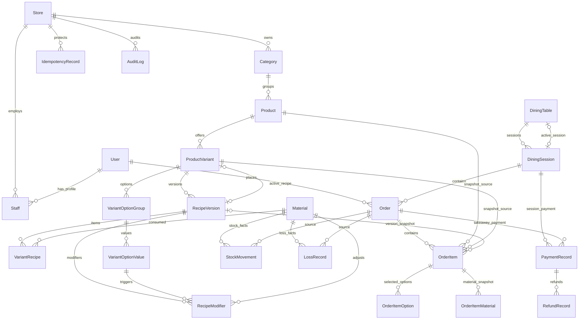

# 任务 3：核心数据模型设计

## 1. 设计结论

复用 V1.2 Schema 作为工程数据模型基线，不重写已审查的订单、桌单、配方、库存和财务模型。

第一阶段新增内容仅限：

- 身份认证所需的员工凭据模型。
- Prisma 迁移工程化。
- 将补充约束纳入可执行迁移。
- 将文档中的事务规则转化为真实数据库集成测试。

完整字段以 [V1.2 Prisma Schema](../../architecture/v1.2/schema.prisma) 为准，本文件说明核心关系、命名映射、约束和事务边界。

## 2. 逻辑 ER 图



## 3. 实体命名映射

| 任务书名称 | 工程模型 | 说明 |
| --- | --- | --- |
| Recipe | `RecipeVersion` 历史 | 一个 Variant 的配方由版本链组成，不在首版额外建立无字段的 Recipe 空壳 |
| RecipeItem | `VariantRecipe` | 配方版本中的原材料明细 |
| RecipeModifier | `RecipeModifier` | 固定数量选项材料调整 |
| TableSession | `DiningSession` | 堂饮桌单 |
| InventoryTransaction | `StockMovement` | 只记录库存数量和预占变化 |
| InventoryLoss | `LossRecord` | 独立记录制作后取消的损耗数量和成本，不与库存流水混用 |

## 4. 类型与金额规则

- 数据库主键：`BigInt`。
- API 中所有 BigInt ID：JSON 字符串。
- 交易金额：`Int`，单位“分”。
- 成本/采购单价：`Decimal(18,6)` 元。
- 原料用量：`Decimal(18,3)`，`Material.unit` 固定规范单位。
- 商品数量：整数。
- 时间：数据库存 UTC，业务展示按 Store 时区。
- 营业日：使用 `Store.timezone` 和 `Store.businessDayCutoffMinute` 计算。

## 5. 核心字段清单

| 实体 | 必要字段 |
| --- | --- |
| Product | id, storeId, categoryId, name, status, sortOrder, deletedAt |
| ProductVariant | id, productId, name, priceFen, inventoryMode, activeRecipeVersionId, status, deletedAt |
| Material | id, storeId, name, unit, onHand, reserved, warningThreshold, purchasePricePerUnit, version |
| RecipeVersion | id, variantId, versionNo, status, effectiveAt, archivedAt, createdByStaffId |
| VariantRecipe | id, recipeVersionId, materialId, role, quantity |
| RecipeModifier | id, recipeVersionId, optionValueId, materialId, targetRole, quantityDelta |
| DiningTable | id, storeId, name, code, capacity, activeSessionId, deletedAt |
| DiningSession | id, storeId, tableId, status, version, openedAt, closedAt, closedByStaffId |
| Order | id, storeId, customerUserId, orderNo, channel, tableId, sessionId, status, subtotalFen, discountFen, totalAmountFen, version, completedAt, cancelledAt |
| OrderItem | id, orderId, productId, variantId, recipeVersionId, snapshots, unitPriceFen, quantity, lineSubtotalFen |
| PaymentRecord | id, paymentNo, storeId, sessionId, orderId, amountFen, receivedAt, operatorStaffId, status |
| RefundRecord | id, refundNo, paymentRecordId, amountFen, reason, refundedAt, operatorStaffId, status |
| StockMovement | id, movementNo, dedupeKey, storeId, materialId, movementType, quantityDelta, reservedDelta, balance snapshots, source order/item |
| LossRecord | id, lossNo, dedupeKey, storeId, materialId, orderId, orderItemId, quantity, cost snapshots, reason, occurredAt |
| IdempotencyRecord | id, storeId, endpoint, idempotencyKey, requestHash, status, responseCode, responseBody, expiresAt |
| AuditLog | id, storeId, actorType, actor ids, action, target, beforeData, afterData, reason, requestId, createdAt |

所有业务表必须保留创建/更新时间或不可变事实时间；历史订单、库存、资金和审计事实不得物理删除。

## 6. 核心实体职责

### 5.1 组织与身份

| 实体 | 核心字段 | 职责 |
| --- | --- | --- |
| Store | id, merchantId, timezone, businessDayCutoffMinute | 单店数据归属边界 |
| User | openid, unionid, status | 顾客身份 |
| Staff | userId, storeId, role, status | 员工在门店内的角色 |
| StaffCredential | staffId, passwordHash 或等效凭据, 锁定字段 | 待身份方案确认后新增 |

单店约束：

- 每个部署只有一个活动 Store。
- 不提供 Store 创建/切换 API。
- `storeId` 必须由认证上下文注入。
- Merchant/Store 的管理端功能不在首版范围。

### 5.2 商品与配方

| 实体 | 核心约束 |
| --- | --- |
| Product | Product 与 Category 同店；社会属性使用软删除 |
| ProductVariant | `inventoryMode = MANAGED / UNMANAGED`；参与库存必须绑定完整 ACTIVE 配方 |
| RecipeVersion | `(variantId, versionNo)` 唯一；只允许 DRAFT → ACTIVE → ARCHIVED |
| VariantRecipe | 只有 DRAFT 可 INSERT/UPDATE/DELETE；材料必须同店 |
| RecipeModifier | 只有 DRAFT 可写；选项值属于当前 Variant；材料同店 |

### 5.3 桌位与订单

| 实体 | 核心约束 |
| --- | --- |
| DiningTable | `(storeId, code)` 唯一；activeSessionId 是活动桌单指针 |
| DiningSession | 同 Table 同时最多一个 OPEN；顾客订单归属同一 Session |
| Order | customerUserId 必填；DINE/TAKEAWAY 目标字段 XOR；状态单向流转 |
| OrderItem | 商品、规格、配方版本和订单必须同店；recipeVersionId 属于当前 variantId |

### 5.4 库存

| 实体 | 核心约束 |
| --- | --- |
| Material | onHand >= 0、reserved >= 0、reserved <= onHand |
| StockMovement | append-only；dedupeKey 唯一；记录来源订单/明细和变化后余额 |
| LossRecord | append-only；`(orderItemId, materialId)` 唯一；记录成本快照，不修改库存 |

`StockMovement` 与 `LossRecord` 分离原因：

- `StockMovement` 是库存数量事实。
- `LossRecord` 是损耗成本与责任归因事实。
- 制作后取消不再扣一次库存，只写 LossRecord。

### 5.5 收款与退款

| 实体 | 核心约束 |
| --- | --- |
| PaymentRecord | sessionId/orderId 必须且只能一个；每笔收款独立流水；金额 > 0 |
| RefundRecord | 必须关联原 PaymentRecord；累计有效退款 <= 原收款；金额 > 0 |
| PaymentStatus | ACTIVE / VOIDED；不物理删除 |
| RefundStatus | ACTIVE / VOIDED；不物理删除 |

### 5.6 技术辅助表

| 实体 | 用途 |
| --- | --- |
| IdempotencyRecord | 防止订单、收款、退款等重复提交 |
| AuditLog | 记录关键操作前后事实，append-only |

## 7. 关键数据库约束

### 6.1 唯一索引

- `dining_tables.activeSessionId` 唯一。
- `dining_sessions.open_table_guard` 生成列唯一，保证同桌一个 OPEN session。
- `recipe_versions.active_variant_guard` 生成列唯一，保证每个 Variant 一个 ACTIVE recipe。
- `stock_movements.dedupeKey` 唯一。
- `loss_records.dedupeKey` 唯一。
- `loss_records(orderItemId, materialId)` 唯一。
- `idempotency_records(storeId, endpoint, idempotencyKey)` 唯一。

### 6.2 CHECK 与触发器

- 金额正负、数量范围、Payment 目标 XOR。
- Product/Category 同店。
- Variant/RecipeVersion 归属一致。
- 订单明细引用当前规格的配方版本。
- DRAFT-only 配方明细写入。
- 配方状态单向流转。
- 退款累计不超过原收款。
- 订单、库存、损耗、收款、退款、审计事实 append-only。

数据库无法安全表达的聚合规则必须在事务服务中实现，并由真实数据库集成测试覆盖。

## 8. 历史快照

订单创建时必须固化：

- 商品名、规格名、售价、数量、行金额。
- 配方版本 ID。
- 选项名称和价格差。
- 原料名称、单位、单杯用量、总用量。
- 原料采购单价与总成本。
- 强度、冲泡方式、备注。

后续修改商品、配方或成本，不得回填历史订单。

## 9. 事务边界

| 事务 | 必须加锁/校验 | 提交结果 |
| --- | --- | --- |
| 创建堂饮首单 | DiningTable 行锁，检查 activeSession 唯一 | Session + Order + Items + StockMovement |
| 同桌加单 | DiningTable 行锁 + Session OPEN | Order + Items + 预占流水 |
| 创建打包订单 | Store/Customer/Policy，库存按 materialId 排序 | Order + Items + 预占流水 |
| 开始制作 | Order 行锁 + version CAS | CONSUME 流水 + PREPARING |
| 制作前取消 | Order 行锁 | RELEASE 流水 + CANCELLED |
| 制作后取消 | Order 行锁；库存不恢复 | LossRecord + CANCELLED |
| 收款 | Session/Order 行锁 + Payment 聚合 | 独立 PaymentRecord |
| 退款 | PaymentRecord 行锁 + 有效退款聚合 | 独立 RefundRecord |
| 关闭桌单 | DiningTable → Session → Orders 固定锁序 | Session CLOSED + 释放桌位 |
| 发布配方 | Variant/RecipeVersion 行锁 | 旧版本归档 + 新版本 ACTIVE |
| 幂等写入 | Idempotency 唯一键 + 同事务响应 | 业务事实 + SUCCEEDED |

固定锁顺序：

```text
DiningTable -> DiningSession -> Order -> Material(materialId ASC)
-> PaymentRecord -> RefundRecord
```

## 10. 第一阶段 Schema 变更建议

### 9.1 必须新增或确认

1. `StaffCredential`：员工登录凭据，具体字段取决于认证方案。
2. 单一 Store 的种子策略。
3. API DTO 的 BigInt 字符串序列化。
4. Prisma 迁移与补充约束的统一可执行路径。

### 9.2 不新增

- 不新增通用规则引擎表。
- 不新增 Redis/消息队列相关表。
- 不新增多租户表。
- 不新增优惠业务表的新用法。

### 9.3 优惠字段处理

推荐保留：

- `Order.discountFen = 0`
- `DiningSession.discountFen = 0`
- `DiscountAllocation` 表保持不删除

但第一阶段：

- 不实现优惠录入 API。
- 不实现优惠分摊服务。
- 不允许任何业务路径写入非零优惠。
- 优惠相关触发器可保留，但需纳入真实迁移验证。

如评审决定从首版迁移移除 `DiscountAllocation`，应作为单独 Schema 变更记录，不静默删除。

## 11. 模型评审门槛

1. 任务书实体名称与现有模型映射确认。
2. 单店 Store 归属根确认。
3. 员工身份方案确认后冻结 StaffCredential 字段。
4. 优惠字段保留策略确认。
5. 事务内核范围确认：数据库验收所需最小服务，不等于完整业务模块。
